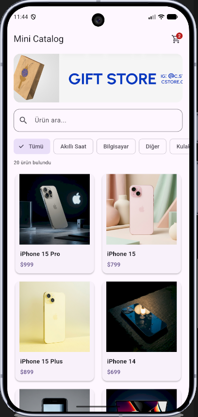
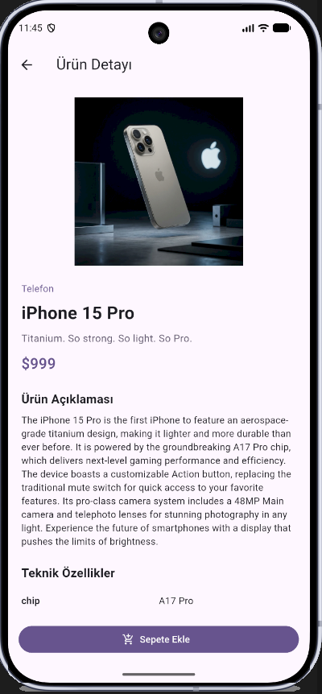
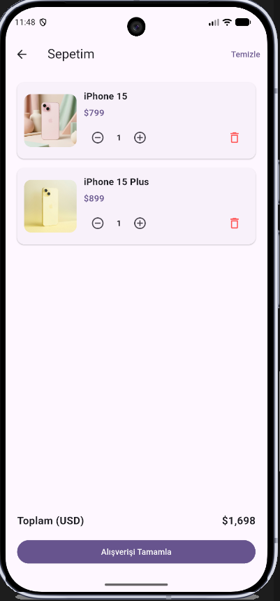
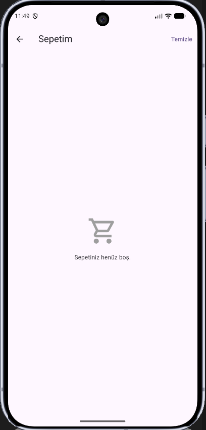

# 🛍️ Mini Catalog — Flutter Mobil Katalog Uygulaması

Flutter ve Dart kullanılarak geliştirilmiş, Material Design 3 tabanlı bir mobil ürün kataloğu uygulamasıdır.

Proje kapsamında ürün verileri bir PHP API üzerinden alınmakta ve kullanıcıya dinamik bir ürün kataloğu sunulmaktadır. Uygulama; ürün listeleme, arama, kategori filtreleme, ürün detaylarını görüntüleme ve alışveriş sepeti yönetimi gibi temel e-ticaret işlevlerini içermektedir.

## 📱 Uygulama Özellikleri

- **Dinamik ürün listeleme:** 
- **Banner:** 
- **Ürün detayları:** 
- **Arama:** 
- **Kategori filtreleme:** 
- **Sepet yönetimi:** 
- **Sepet sayacı:** 
- **Toplam fiyat:** 
- **Kalıcı sepet:** 
- **Ürün görselleri:** 
- **Para birimi desteği:** 
- **Hata yönetimi:** 

## 🛠️ Kullanılan Teknolojiler

| Teknoloji | Kullanım amacı |
|---|---|
| Flutter | Mobil uygulama geliştirme |
| Dart | Programlama dili |
| Material Design 3 | Kullanıcı arayüzü |
| PHP API | Ürün verilerinin sağlanması |
| HTTP | API üzerinden veri çekme |
| JSON | Veri alışverişi ve model dönüşümü |
| SharedPreferencesAsync | Sepet verilerinin kalıcı olarak saklanması |
| ChangeNotifier | Sepet durum yönetimi |
| StatefulWidget / setState | Arama ve kategori filtreleme |
| Navigator / MaterialPageRoute | Sayfalar arası geçiş |
| intl | Fiyat biçimlendirme |
| flutter_test | Unit ve widget testleri |

### Flutter Sürümü

Projenin geliştirildiği Flutter sürümü:

`flutter --version` komutuyla kullanılan sürüm bilgisi buraya eklenecektir.

## 🌐 API Entegrasyonu

Uygulama, ürün bilgilerini WantAPI tarafından sağlanan eğitim amaçlı PHP servisinden almaktadır.

**Ürün API'si:**

https://wantapi.com/products.php

**Banner:**

https://wantapi.com/assets/banner.png

### Veri Akışı

1. Uygulama başlatılır.
2. `loadProducts()` fonksiyonu HTTP GET isteği gönderir.
3. API'den gelen JSON yanıtı ayrıştırılır.
4. `data` dizisindeki ürünler `Product.fromJson()` ile modellere dönüştürülür.
5. Ürünler katalog ekranında listelenir.
6. API isteği başarısız olursa kullanıcıya hata ekranı ve **Tekrar Dene** butonu gösterilir.

### Ürün Veri Modeli

API'den alınan ürünlerde aşağıdaki alanlar kullanılmaktadır:

- `id`: Ürün kimliği
- `name`: Ürün adı
- `tagline`: Kısa tanıtım metni
- `description`: Ürün açıklaması
- `price`: Ürün fiyatı
- `currency`: Para birimi
- `image`: Ürün görselinin URL adresi
- `specs`: Teknik özellikler

Kategori bilgisi API tarafından sağlanmadığında uygulama ürün adına göre kategori eşleştirmesi yapmaktadır.

Ürün fiyatları için döviz kuru dönüşümü uygulanmaz; kaynak verideki para birimi korunur.


## 📂 Proje Klasör Yapısı

```text
mini-catalog/
├── android/
├── ios/
├── lib/
│   ├── main.dart
│   ├── data/
│   │   └── products.dart
│   ├── models/
│   │   ├── product.dart
│   │   └── cart_item.dart
│   ├── pages/
│   │   ├── product_list_page.dart
│   │   ├── product_detail_page.dart
│   │   └── cart_page.dart
│   ├── services/
│   │   └── cart_store.dart
│   ├── utils/
│   │   └── price_formatter.dart
│   └── widgets/
│       ├── product_card.dart
│       └── product_image.dart
├── test/
│   ├── product_test.dart
│   ├── price_formatter_test.dart
│   └── widget_test.dart
├── docs/
│   └── screenshots/
│       ├── catalog.png
│       ├── detail.png
│       └── cart.png
├── pubspec.yaml
└── README.md
```

## 🖼️ Uygulama Ekran Görüntüleri

### Ürün Kataloğu

Banner, arama alanı, kategori filtreleri ve API üzerinden alınan ürünlerin listelendiği ana ekran.



### Ürün Detayı

Ürünün görseli, açıklaması, fiyatı, teknik özellikleri ve sepete ekleme butonunun bulunduğu ekran.



### Alışveriş Sepeti

Sepetteki ürünlerin, miktarlarının ve toplam fiyatlarının görüntülendiği ekran.




## ⚙️ Kurulum

### Gereksinimler

- Flutter SDK
- Dart SDK
- Android Studio ve Android SDK
- Android Emulator veya fiziksel Android cihaz
- VS Code veya Android Studio
- İnternet bağlantısı

### 1. Projeyi klonlayın

```bash
git clone https://github.com/nurguzay/mini-catalog.git
cd mini-catalog
```

### 2. Bağımlılıkları yükleyin

```bash
flutter pub get
```

### 3. Kullanılabilir cihazları listeleyin

```bash
flutter devices
```

### 4. Uygulamayı çalıştırın

```bash
flutter run
```

Belirli bir Android emülatöründe çalıştırmak için:

```bash
flutter run -d emulator-5554
```

## 🧩 Uygulama Mimarisi

### Models

**product.dart**

API'den alınan ürün bilgilerini temsil eden veri modeli. JSON dönüşümleri ve kategori belirleme işlemlerini içerir.

**cart_item.dart**

Sepetteki ürünün miktarını ve ara toplamını temsil eder.

### Data

**products.dart**

WantAPI'ye HTTP GET isteği göndererek ürün verilerini getirir ve `Product` nesnelerine dönüştürür.

### Pages

**product_list_page.dart**

Ürün kataloğu, banner, arama, kategori filtreleme ve sepet sayacını içerir.

**product_detail_page.dart**

Seçilen ürünün detaylarını, teknik özelliklerini ve sepete ekleme işlemini içerir.

**cart_page.dart**

Sepet içeriğini, miktar güncelleme işlemlerini ve toplam tutarı gösterir.

### Services

**cart_store.dart**

ChangeNotifier kullanarak ortak sepet durumunu yönetir. SharedPreferencesAsync ile sepet bilgilerinin cihazda saklanmasını sağlar.

### Widgets

**product_card.dart**

Ürünleri GridView içerisinde kart biçiminde görüntüler.

**product_image.dart**

Ürün görsellerini uzak URL üzerinden yükler ve görsel hatalarını yönetir.

### Utils

**price_formatter.dart**

Ürün fiyatlarını para birimine uygun biçimde görüntüler.

## 💾 Veri Yönetimi

### Ürün Verileri

Uygulama, ürünleri yerel JSON dosyasından değil, WantAPI üzerinden almaktadır.

Ürün bilgileri HTTP GET isteğiyle alınır ve JSON formatından Dart nesnelerine dönüştürülür.

API bağlantısı başarısız olduğunda ürünler yüklenmez. Kullanıcı bağlantısını kontrol ederek yeniden deneyebilir.

### Sepet Verileri

Sepet işlemleri `CartStore` üzerinden yönetilir.

Desteklenen işlemler:

- Ürün ekleme
- Miktar artırma
- Miktar azaltma
- Ürün kaldırma
- Sepeti temizleme
- Toplam tutar hesaplama

Sepet verileri `SharedPreferencesAsync` kullanılarak cihaz üzerinde saklanır.

Uygulama yeniden başlatıldığında kayıtlı ürünler, API'den alınan güncel katalogla eşleştirilerek sepet geri yüklenir.

## 🧪 Testler

### Kod Analizi

```bash
flutter analyze
```

### Otomatik Testler

```bash
flutter test
```

### Test Kapsamı

- Product modelinin JSON dönüşümleri
- Sepet ara toplam hesaplaması
- Boş sepet widget testi
- Fiyat biçimlendirme işlemleri

API entegrasyonu ve model değişiklikleri sonrasında testlerin yeniden çalıştırılması gerekmektedir.

## 📦 Android APK Oluşturma

Release APK oluşturmak için:

```bash
flutter build apk --release
```

APK çıktısı:

```text
build/app/outputs/flutter-apk/app-release.apk
```

İşlemci mimarisine özel APK dosyaları oluşturmak için:

```bash
flutter build apk --split-per-abi
```

Oluşturulan APK Android cihazlarda test amacıyla kullanılabilir.

## ⚠️ Proje Kapsamı ve Sınırlamalar

Bu proje eğitim amacıyla geliştirilmiştir.

- Gerçek ödeme sistemi bulunmamaktadır.
- Kullanıcı kaydı ve giriş sistemi bulunmamaktadır.
- Ürün verileri eğitim amaçlı harici API'den alınmaktadır.
- API sunucusunun geliştirilmesi ve yönetimi bu projenin kapsamında değildir.
- Sepet verileri cihazın yerel depolamasında tutulmaktadır.
- Sipariş oluşturma ve ödeme işlemleri gerçekleştirilmemektedir.
- Ürünlerin yüklenebilmesi için aktif internet bağlantısı ve erişilebilir API gerekmektedir.
- Çevrimdışı ürün kataloğu bulunmamaktadır.

## 🎯 Kazanımlar

Bu proje kapsamında aşağıdaki konular uygulanmıştır:

- Flutter widget mimarisi
- Material Design 3
- StatelessWidget ve StatefulWidget
- GridView ve ListView
- Navigator ile sayfa geçişleri
- JSON modelleme
- fromJson / toJson dönüşümleri
- HTTP GET istekleri
- Asenkron programlama
- API hata yönetimi
- Dinamik listeleme ve filtreleme
- ChangeNotifier ile state yönetimi
- SharedPreferences ile veri kalıcılığı
- Uzak sunucudan görsel yükleme
- Unit ve widget testleri
- Android emülatöründe test
- Release APK oluşturma

## 📌 Proje Durumu

Mini Catalog'un temel katalog ve sepet işlevleri geliştirilmiştir.

Yerel ürün verisi kullanımı kaldırılarak ürünlerin WantAPI üzerinden yüklenmesi sağlanmış ve API bağlantı hataları için yeniden deneme mekanizması eklenmiştir.

Uygulama Android emülatöründe çalıştırılmıştır. Son kod değişikliklerinin ardından otomatik testlerin ve release APK'nın yeniden doğrulanması gerekmektedir.

---

**Geliştirme Ortamı:** Flutter / Dart / Android Studio / VS Code

**Proje Türü:** Flutter Mobil Uygulama Geliştirme

**Platform:** Android

**Repository:** https://github.com/nurguzay/mini-catalog